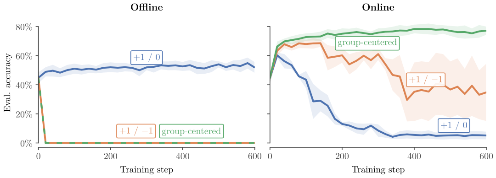
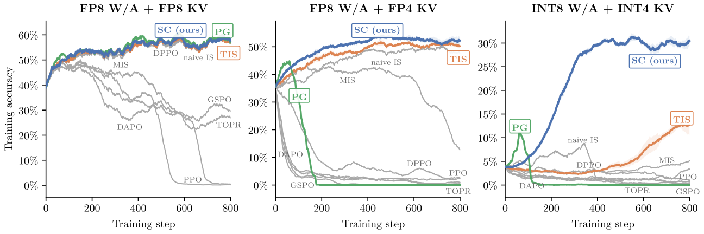
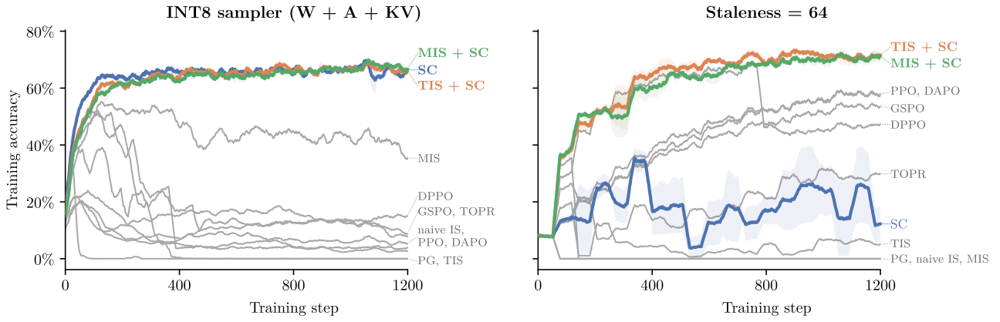

> **论文**：[Score Centering Stabilizes Off-policy Reinforcement Learning](https://arxiv.org/html/2609.20807v1)
>
> **作者**：Martin Marek、Max Ryabinin
>
> **机构**：Together AI
>
> **版本**：arXiv:2609.20807v1，2026-09-17
>
> **代码**：[martin-marek/score-centering](https://github.com/martin-marek/score-centering)

LLM 的强化学习通常由两套引擎协作：采样器生成回答，训练器在这些回答上计算梯度。即使加载同一份权重，它们的 next-token 概率也可能因为量化、计算 kernel 或参数同步延迟而不同。这种 training-inference mismatch（TIM，训练推理失配）有时很小，却能让训练经过几百步后崩溃。

这篇论文提出一个具体解释：**失配使 policy gradient 多出一项不区分回答好坏的 drift；采样器又不断从训练器同步权重，于是偏差在反馈循环中累积。** 作者据此提出 score centering，直接减去采样分布下的期望 score，消掉这项漂移。

这里的 score 指 $\nabla_\theta\log p_\theta$，即对数概率对模型参数的梯度，不是奖励分数。方法中心化的是这个梯度向量。实验中，它在严重量化下优于多种重要性采样修正规则；在严重参数滞后下，则需要与重要性采样组合。

## 同一份模型为什么会有两种概率

用 $p_\theta$ 表示训练器的策略，$q$ 表示实际产生 rollout 的采样器策略。理论上的 on-policy 要求二者相同；实际系统中有三类常见偏差：

- **计算精度或实现不同。** 采样器可能使用更低精度的权重、activation 或 KV cache，训练器则使用 bf16；两套代码也可能采用不同的 kernel。
- **浮点计算顺序不同。** 即使使用同一 kernel，自回归解码和整段并行训练的输入形状不同，也可能改变 reduction 顺序。浮点加法不满足结合律，因此输出不保证完全相同。
- **参数滞后。** 异步系统中，采样器可能仍在使用旧 checkpoint；一条长轨迹的不同片段甚至可能来自不同版本。

消除这些差异往往要牺牲吞吐量。论文因此研究：能否容忍采样器和训练器不同，同时让梯度更新保持稳定？

常见解法是 importance sampling（IS，重要性采样）。对完整轨迹 $y$，在采样分布覆盖目标分布的条件下，有

$$
\mathbb E_{y\sim p_\theta}[R(y)\nabla_\theta\log p_\theta(y)]
=\mathbb E_{y\sim q}\left[\frac{p_\theta(y)}{q(y)}R(y)\nabla_\theta\log p_\theta(y)\right].
$$

$R(y)$ 是轨迹奖励，$p_\theta(y)/q(y)$ 把来自 $q$ 的样本重新加权，使期望对应 $p_\theta$。问题是比值可能很大，导致梯度方差增加。实践中常采用 token 级近似，并对比值截断或屏蔽：TIS（Truncated Importance Sampling）限制最大权重，MIS（Masked Importance Sampling）丢弃比值落在指定范围之外的项。这些处理改善数值稳定性，也引入了偏差。

Score centering 从另一个角度切入：先找出失配引入的具体漂移项，再做加法修正。[论文第 2 节](https://arxiv.org/html/2609.20807v1#S2)

## 一个反常现象：只奖励成功样本，在线训练反而最不稳定

作者先用 Qwen3-1.7B 在 Countdown 上做控制实验。Countdown 要求模型用给定数字和运算构造目标值。实验给采样器权重加入固定的小扰动，比较两种更新方式：offline 固定采样器，online 持续把训练器权重同步回采样器。

同时比较三种奖励：成功/失败为 $+1/0$、成功/失败为 $+1/-1$，以及减去同一问题组内均值的 group-centered reward。

*原论文 Figure 2：横轴为训练步数，纵轴为 held-out evaluation accuracy。左图固定采样器时，蓝色 $+1/0$ 稳定，含负值的另外两种方式迅速崩溃；右图在线同步时，蓝线反而跌到接近零，绿色组内中心化最稳定。阴影为均值的 ±1 标准误，每条曲线使用 3 个随机种子。*

固定数据、只用正向奖励的更新接近成功样本上的 SFT，训练器拟合一个固定目标。在线时，训练器每次拟合的却是自身一个有偏的副本；更新后的权重又回到采样器，目标随之移动。这个对比使作者把在线反馈循环作为分析重点。

它也提醒我们区分两种不稳定：离线负奖励可能使某些 log probability 无界下降；本文主要解释的是在线失配下另一种持续累积的偏差，不能用同一个原因概括二者。[论文第 3 节](https://arxiv.org/html/2609.20807v1#S3)

## 从零均值恒等式推导 drift

### 没有学习信号时，期望更新应该为零

固定一个已经生成的前缀 $h$。设词表 token 为 $v$，训练器和采样器的 next-token 概率分别为 $p_v$ 和 $q_v$，并定义

$$s_v=\nabla_\theta\log p_v,\qquad \bar s=\sum_v q_v s_v.$$

$s_v$ 是选择 token $v$ 时的 score，$\bar s$ 是在采样器分布下平均之后的 score。以下期望都以这个前缀为条件，$R$ 可以是原始奖励，也可以是中心化后的 advantage，并且可以依赖后续生成的整条回答。

在训练器自己的分布下，score 有一个恒等式：

$$\mathbb E_p[s_v]=\sum_v p_v\nabla_\theta\log p_v=\nabla_\theta\sum_v p_v=0.$$

因此，假如环境不论生成什么都给常数奖励 $R=1$，on-policy 的期望更新就是零：没有回答比其他回答更好，自然没有需要学习的偏好。

但样本来自 $q$ 时，$\bar s=\mathbb E_q[s_v]$ 一般不为零。即使奖励恒定，未经修正的 policy gradient 仍会推动参数变化。

一个两 token 的例子就能看出问题。假设训练器的概率为 $p=(0.6,0.4)$，采样器为 $q=(0.7,0.3)$。对 softmax logits 而言，采样 token 的 score 是“该 token 的 one-hot 向量减去 $p$”，所以平均更新为 $q-p=(0.1,-0.1)$。没有任何奖励差异，训练器却会继续提高第一个 token 的概率，只因为采样器更偏好它。

### 把更新拆成平均奖励驱动的漂移和协方差信号

利用协方差恒等式，固定前缀上的期望更新可写为

$$
\underbrace{\mathbb E_q[R\,s_{y_t}]}_{\text{原始更新}}
=\underbrace{\mathbb E_q[R]\,\bar s}_{\text{drift}}
+\underbrace{\operatorname{Cov}_q(R,s_{y_t})}_{\text{signal}}.
$$

$y_t$ 是实际采样到的 token。右侧第一项只用到平均奖励，不关心哪个 token 对应更好的结果；第二项才描述奖励高低与 score 方向之间的关联。作者把前者称为 drift，后者称为学习信号。

漂移方向 $\bar s$ 恰好对应“把训练器向采样器做交叉熵拟合”的更新方向。平均奖励为正时，训练器被推向采样器；为负时，则被推离。固定的 teacher 至少提供一个固定拟合目标，而在线采样器会不断接收训练器的新参数，持续的数值偏差可能由此形成反馈循环。

这是论文的主要机制解释。恒等分解本身是精确的；“这种反馈导致实际训练崩溃”则还需要后面的控制实验支持。[论文第 4 节](https://arxiv.org/html/2609.20807v1#S4)

## Score centering 消掉什么，又保留什么

方法直接把每个 token 的 score 换成

$$\widetilde s_{y_t}=s_{y_t}-\bar s.$$

由于同一前缀下 $\bar s$ 是确定向量，$\mathbb E_q[\widetilde s]=0$，期望更新变成

$$\mathbb E_q[R\,\widetilde s_{y_t}]=\operatorname{Cov}_q(R,s_{y_t}).$$

漂移项被消掉，奖励与 token 之间的协方差仍在。这里的“消掉”指完整分布下的期望性质，不是每个 minibatch 都恰好没有噪声。当 $p=q$ 时，$\bar s$ 原本就是零，因此修正不改变更新。

不过，这没有把 off-policy 梯度完全变成 on-policy 梯度。剩下的协方差仍按采样器 $q$ 计算；目标策略的梯度应按 $p$ 计算。若采样器过旧，访问到的 token 和前缀已经明显偏离当前策略，单独消除 drift 仍然不够。这是后面严重 staleness 实验中需要组合 IS 的原因。

### 它与 reward centering 的区别

GRPO 的 group centering 使同一道题的优势之和为零，却不保证每个具体前缀的期望优势为零。一个大概率通向正确答案的前缀，其条件期望优势通常为正；已经走错的前缀则可能为负。因此，按问题中心化奖励会缩小 drift，却不保证在每个前缀消除它。

如果有一个精确的、以当前前缀为条件的 value baseline，减去该前缀的期望奖励，同样可以在期望上消除这项漂移。Score centering 改为减去期望 score，无需训练 critic。它与常规 reward baseline 的目标也不同：后者在 on-policy 时通常用于降低方差，前者在 off-policy 时用于修正更新均值。

## 怎样实现，而不用保存整个词表

### 标量 loss 与 stop-gradient

不需要显式生成或保存参数维度的梯度向量。完整词表版本可写成普通标量 loss：

$$
L=-R\left(\log p_{y_t}-\sum_v\operatorname{sg}[q_v]\log p_v\right).
$$

$\operatorname{sg}$ 表示 stop-gradient，奖励或优势 $R$ 也作为固定系数。对 $L$ 求导后，梯度下降对应的方向正是 $R(s_{y_t}-\bar s)$。减去的项在形式上类似一项带相反符号的交叉熵，用于抵消更新中隐含的、向采样器拟合的部分。

保存每个位置的完整 $q$ 分布仍然很贵。作者实际只记录采样器 top-$k$ token 的 ID 和 log probability，默认 $k=128$。设这部分 token 集合为 $H$，剩余 tail 用训练器的概率分布近似，并按总质量重新缩放：

$$
\widehat q_v=\begin{cases}q_v,&v\in H,\\ \rho p_v,&v\notin H,\end{cases}
\qquad
\rho=\frac{1-\sum_{v\in H}q_v}{1-\sum_{v\in H}p_v}.
$$

$\rho$ 使近似分布总和为 1。再利用 $\sum_v p_v s_v=0$，中心化项可化简为

$$\mathbb E_{\widehat q}[s_v]=\sum_{v\in H}(q_v-\rho p_v)s_v.$$

因此，采样器只需额外提供 top-$k$ 概率，修正项也只涉及这 $k$ 个 token。对应的系数 $q_v-\rho p_v$ 必须整体 stop-gradient；否则自动微分会额外对系数求导，更新不再等于上述中心化公式。

这个实现是对 $\widehat q$ 精确中心化，对真实 $q$ 则存在 tail 建模误差。论文的消融显示，$k=32$、$k=128$ 与完整词表版本在测试设置中表现相近。默认 top-128 平均覆盖超过 99.9% 的采样概率质量，最严重量化的 30B 设置中约为 99.45%。作者自建 JAX 系统的额外端到端时间在 1% 以内；vLLM、SGLang 的实际开销没有在文中测量。[附录 A](https://arxiv.org/html/2609.20807v1#A1)

### 与 TIS 或 MIS 组合时，要中心化加权后的 score

若重要性采样规则给 token 的权重是 $w_v=f(p_v/q_v)$，组合更新为

$$R\left(w_{y_t}s_{y_t}-\mathbb E_q[w_vs_v]\right).$$

这里减去的是加权 score 的期望。直接减去原始 $\bar s$ 不能保证消除 IS 截断后残留的漂移。对于未截断的精确 IS，$q_vw_v=p_v$，加权 score 的期望已经为零，SC 修正自然消失。它主要为实际使用的截断、屏蔽规则补上剩余的中心化修正。

## 实验里哪些结果最有说服力

所有方法都放在相同的 REINFORCE + group-centered rewards 目标上比较，使用同样的采样器、训练器、优势和优化器，每批只做一次 SGD 更新。这样可以隔离修正规则的作用。它比较的是 PPO、DAPO、IcePop 等方法中的 correction rule，并未复现各自完整的动态采样、长度惩罚或其他训练配方。

### 30B 量化实验中的差距随失配增大

主实验在 Qwen3-30B-A3B-Base 上训练 INTELLECT-2 数学数据。这是总参数约 30B、激活参数约 3B 的 MoE；采样器与训练器还可能存在专家路由差异，实验没有重放 router indices。

*原论文 Figure 1：横轴为训练步数，纵轴为训练准确率，蓝线为 SC、橙线为 TIS、绿线为未修正的 policy gradient（PG）。三图依次加强采样器量化，训练器保持 bf16。W/A 表示权重与 activation，KV 表示 KV cache。左图 PG、SC、TIS 接近；中图 PG 约 200 步内崩溃，SC/TIS 稳定；右图 SC 与 TIS 明显分开。各曲线阴影为 ±1 标准误，随机种子数并不相同。*

下面整理的是第 5.4 节报告的近似训练结果，不能当作 held-out benchmark 分数：

| 采样器设置 | 未修正 PG | TIS | SC | 其他结果 |
|---|---:|---:|---:|---|
| FP8 W/A + FP8 KV | 约 58%，稳定 | 与 PG 相近 | 与 PG 相近 | 温和失配下，最强方法差距很小 |
| FP8 W/A + FP4 KV | 200 步内崩溃 | 约 51% | 约 52% | MIS 在训练后期崩溃 |
| INT8 W/A + INT4 KV | 最终低于 5% | 约 12% | 约 30% | 除 SC、TIS 外，其余方法最终均低于 5% |

最有说服力的是右图的 30% 对 12%，以及未经修正方法的崩溃；中图 52% 对 51% 则更适合解释为两种方法均能稳定训练。这里支持的是对量化失配的耐受能力，不能据此推出模型的独立数学泛化能力提升了同样幅度。

### 参数滞后时，SC 与 IS 的互补性更明确

0.6B 的 Countdown 实验分别测试 INT8 采样器，以及每 64 个训练步才同步一次的采样器。后者是固定间隔 64 步才更新，并非只要求最大滞后不超过 64 步。

*原论文 Figure 4：横轴为训练步数，纵轴为训练准确率，每条曲线使用 3 个种子。左图 INT8 量化下，SC、TIS+SC、MIS+SC 都达到约 65%–70%；右图严重滞后下，组合方法达到约 70%，单独 SC 则明显更低且波动较大。*

这一结果限定了 SC 的作用：量化设置中，移除 drift 已经非常有效；策略版本相差较远时，还要处理采样分布与目标分布之间的差别。作者因此建议在 trainer 可能明显远离 sampler 时组合使用 SC 和 IS。

### 控制噪声实验支持偏差积累的解释

作者还在训练开始时给采样器权重加入固定的高斯偏移。随噪声增强，崩溃时间提前：DPPO 大约在第 160、80、20 步崩溃；TIS 在最低噪声下稳定，在更大两档噪声下约第 180、40 步崩溃。最强噪声下，只有 SC 及其与 TIS/MIS 的组合稳定。该图使用 held-out evaluation accuracy，比只观察训练奖励多了一层支持。

不过，固定权重噪声是人为构造的偏差源。论文明确表示，为了在几百步内区分方法，实验刻意使用较强失配；0.6B 和 30B 的最大序列长度也只有 512、1024。作者把它们作为温和失配长期积累的代理实验，这个对应关系是研究动机，尚不是已经验证的等价关系。[实验与附录 B](https://arxiv.org/html/2609.20807v1#S5)

## 思考与讨论

**稳定性修正可以让系统设计保留更多吞吐空间。** 如果数值完全一致的 kernel 或频繁权重同步很昂贵，SC 提供了一种算法补偿。实际取舍还取决于采样速度收益、记录 top-$k$ 的成本和相同算力下的最终质量；本文的 JAX 开销结果为这条路线提供了初步依据。

**SC 与 critic 的关系值得进一步比较。** 精确的前缀 value baseline 和 score centering 能在期望上消除同一 drift，但二者的估计难点不同：前者要预测长期回报，后者要获取采样器的局部分布。SC 可以避免为这个目的单独训练 value model，但并不替代 critic 在长程 credit assignment、降低优势方差等方面的作用。异步长轨迹训练中，两者可能互补。

**“哪种 mismatch”比一个总体大小指标更有解释力。** 量化偏差、旧 checkpoint、MoE 路由差异都会让 $p\ne q$，却不一定以相同方式影响梯度。本文已经发现 SC 单独处理量化有效、处理严重 staleness 不够。未来若能分别测量 drift 和协方差偏差，可能比仅监控 sampled-token importance ratio 更容易定位崩溃原因。

## AI 犀利评判

**压力测试不能直接替代真实生产训练。** 作者主动放大量化和 staleness，最长序列只有 512/1024，并把结果作为温和 TIM 长期积累的代理。较强偏差的短程反馈，与长上下文、多次更新、异步工具交互中的偏差未必产生同样动态。因此，“在这些设置中 drift 是关键因素”有直接证据，“解释了实际 LLM RL 中大多数崩溃”仍然超出验证范围。

**主图的准确率首先是训练稳定性指标。** 30B 主图和 staleness 图报告训练准确率；held-out 结果主要出现在在线/离线对照和小模型噪声实验。它们足以说明 SC 避免某些修正规则的崩溃，却不足以建立同算力下对独立数学 benchmark 的质量优势。比较对象也只是共享目标上的 correction rule，不是完整 PPO、DAPO、IcePop 系统。

**理论上的精确消漂移，不等于实际更新无偏。** 完整分布 SC 保留的是 $q$ 下的协方差，top-$k$ 又把真实分布换成了 $\widehat q$。低 tail mass 和消融一致性支持这个近似在当前实验中可用，不能单独保证 tail 对参数梯度的影响始终小。严重 staleness 下 SC 单独表现较差，正是剩余偏差有实际后果的证据。

**30B 的统计支持需要按面板和方法区分。** 温和 FP8 面板全部单种子；FP4 KV 面板中 SC/TIS 分别为 5/4 个种子，INT4 KV 面板为 4/3 个，其他多个基线只有一个种子。论文公开了这些数量并给出标准误，优于只展示单条最佳曲线，但不能把所有方法间差距都视为同等可靠。尤其 52% 对 51% 不应和 30% 对 12% 一起概括成同样强的胜出。

总体判断：score centering 提供了一个推导清楚、实现成本较低的漂移修正，在量化压力测试中证据充分；它能成为 off-policy RL 的有用组件，长期真实训练中的收益以及与完整训练配方的兼容性仍需进一步验证。
