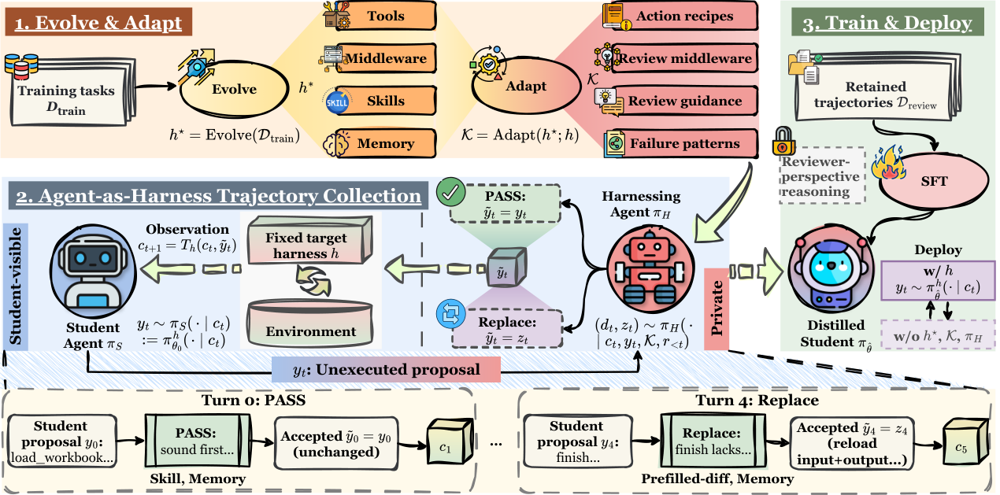

> **论文**：[Harness-Zero: Harness Distillation via Agent-as-Harness](https://arxiv.org/html/2609.24974v1)
>
> **作者**：Haoran Ye、Yuxing Lu、Haonan Dong、Zhaochen Su、Guojie Song
>
> **机构**：北京大学智能科学与技术学院、通用人工智能全国重点实验室；北京大学未来技术学院；Google；香港科技大学
>
> **版本**：arXiv:2609.24974v1，2026-09-21
>
> **代码**：[metaevo-ai/harness-zero](https://github.com/metaevo-ai/harness-zero)

一个 Agent 在处理表格时，可能靠外部规则记得“先看示例、只改空白格、保存后重新检查”；换一个执行框架，这些习惯就消失了。模型参数没有变，改变的是围绕模型运行的 harness：工具、流程控制、技能文档和记忆。

Harness-Zero 研究的是：能不能把这些外部机制带来的行为，变成模型在一个固定、精简的执行框架下也会主动完成的步骤？作者用强模型逐步审阅学生的动作，把 harness 规则转化为可执行的修正，再对接受后的轨迹做监督微调。

在 Qwen3.5-9B 上，三个领域的宏平均成绩从 23.3% 提升到 44.3%，超过原模型挂载专用 harness 的 41.7%。不过，三个领域是**分别训练**的；这里还没有得到一个同时掌握全部领域的通用模型。[论文 §4.3、附录 E](https://arxiv.org/html/2609.24974v1#S4.SS3)

## 为什么不能直接模仿带着复杂 harness 的 Agent

这里的 harness 不只是 system prompt。论文按照四类组件组织它：

| 组件 | 它在模型外部做什么 | 论文中的例子 |
|---|---|---|
| Tools，工具 | 扩展模型可以直接调用的动作 | 逆合成候选生成、SMILES 分子表示检查 |
| Middleware，中间件 | 在执行前后检查、阻断或改变流程 | 发现表格预填示例被覆盖时，拒绝结束任务 |
| Skills，技能 | 提供可复用的工作流程 | 先检查工作簿，再编辑，最后验证 |
| Memory，记忆 | 记录反复发生的失败及其应对方式 | 不要只用自己写出的结果验证自己的计算 |

这些组件能改善成功率，却也带来部署负担：不同任务需要不同规则，升级模型后旧规则可能需要调整，还要维护工具接口、上下文与路由。

一个直接方案是：让配备复杂 harness 的 Agent 完成任务，然后用它的轨迹训练一个轻量 Agent。困难在于，示范和部署时的接口可能不同。示范里出现了专门的 `smiles_check` 工具，学生部署时却只有 Bash；外部中间件在后台做了检查，轨迹里也未必有“如何主动检查”的动作。直接模仿可能学到不存在的接口，或者根本看不到支撑成功的关键步骤。

作者因此区分三个对象：

- $h$：学生最终使用的固定目标 harness。本文采用 mini-SWE-agent 风格的精简框架，对外只有一个执行 Bash 的 `execute` 工具。
- $h^\star$：在训练任务上优化出来的学生侧 harness，包含领域工具、规则和经验。
- $\mathcal K$：把 $h^\star$ 改写后，交给审阅 Agent 私下使用的参考 harness。

蒸馏的目标是让学生在 $h$ 下主动完成原先由 $h^\star$ 诱导或强制的行为。$h$ 仍然负责执行动作、返回观察和保存文件状态，所以论文标题中的 Zero 指向移除专用 harness，而不是完全没有运行环境。

## 先把执行机制改写成审阅依据

*原论文 Figure 1：左上是演化与改写，橙色四类组件被转换成右侧粉色的参考组件；中间蓝色区域是学生可见的执行循环，红色审阅 Agent 根据私有参考材料选择 PASS 或 Replace；右侧用接受后的轨迹做 SFT，部署时只保留学生与目标 harness。底部例子中，第 0 轮加载工作簿被放行，第 4 轮过早结束则被替换成重新加载并比较输入输出的检查动作。*

第一步，作者在每个领域分别构建一个共享的 $h^\star$。演化流程运行三轮：分析上一轮失败的训练任务，提出可复用的组件改动，由主演化 Agent 合并，再让学生挂载新 harness 评测。已经通过的任务退出后续轮次。规则要求组件面向一类失败，不能把某一道题的答案或专用路径写进去。

第二步是 adaptation：保留组件想实现的行为，改变它的使用者和生效位置。对应关系覆盖前面的全部四类组件：

| 学生侧的 $h^\star$ | 审阅侧的 $\mathcal K$ | 最终怎样进入学生轨迹 |
|---|---|---|
| 直接可调用的工具 | Action recipe，动作实现配方 | 审阅 Agent 生成 Bash/Python 等学生能执行的等价动作 |
| 直接控制执行循环的中间件 | Review middleware，审阅检查 | 条件触发时私下提醒审阅 Agent，再由它修正下一步 |
| 给学生看的技能流程 | Review guidance，审阅指南 | 识别学生漏掉的步骤，补成当前状态下可执行的动作 |
| 学生侧失败记忆 | Failure patterns，失败模式 | 将经验改写为“观察到什么时，应该怎样干预” |

例如，原中间件会在学生宣布结束时进入沙箱，比较输入、输出工作簿，发现预填单元格被覆盖就阻断结束。改写后的审阅中间件不会私下读取学生文件，而是检查可见轨迹：有没有做过输入输出比较？如果没有，就提示审阅 Agent 把“任务完成”替换成一条实际比较工作簿的命令。

这条命令通过 $h$ 执行，检查结果也通过 $h$ 返回。学生因此看见了“做检查—得到证据—继续处理”的完整过程，而不是凭空获得一个来自外部的纠正结论。[论文附录 B](https://arxiv.org/html/2609.24974v1#A2)

## Agent-as-harness：在执行前修正下一步

传统的 code-as-harness 让程序规则直接包围学生、控制执行。Agent-as-harness 则让一个 harnessing agent（下文称审阅 Agent）解释这些规则，并在学生每次回复尚未执行时决定是否修改。

第 $t$ 步可以写为：

$$
y_t\sim\pi_S(\cdot\mid c_t),\qquad
\tilde y_t=
\begin{cases}
y_t,&\text{PASS},\\
z_t,&\text{REPLACE},
\end{cases}
\qquad
c_{t+1}=T_h(c_t,\tilde y_t).
$$

$c_t$ 是学生目前可见的任务、历史动作与环境观察；$\pi_S$ 是学生策略，$y_t$ 是它提出的回复；$z_t$ 是审阅 Agent 给出的完整替代回复；$\tilde y_t$ 是最终接受的版本；$T_h$ 表示通过目标 harness 执行动作并把观察加入上下文。

审阅 Agent 额外看到 $\mathcal K$ 和自己的历史审阅记录，但只有 $\tilde y_t$ 及其执行结果进入学生上下文。被拒绝的草稿、审阅理由、私有组件路径都不会成为学生轨迹的一部分。审阅 Agent 的会话贯穿整次任务，因此可以记住之前做过的检查和干预。

为了让修正可学、可复现，协议有三个关键约束：

1. **修正必须符合学生的动作接口。** 学生只有一个 `execute` 工具，就不能突然调用参考 harness 的私有工具。替代回复必须是完整、有效的学生回复。
2. **新增的环境证据必须由学生动作获得。** 审阅 Agent 不能访问学生沙箱、隐藏答案或 verifier 反馈；若需要文件内容，就生成读取命令，让结果进入学生可见历史。
3. **尽量做最小的完整修正。** 合理的替代方案、无害的低效和有用的探索应当放行；能让学生观察错误并自行恢复的步骤也可以保留。干预负责补上关键行为，然后交还控制权。

第三点不是保证修正一定接近学生原分布，而是一条数据生成原则。审阅者可以引入学生原本不会主动执行的步骤；后续轨迹也已经受到这些干预的影响。因此，较准确的理解是“沿学生参与的实时交互轨迹纠正动作”，不能把全部接受动作都当成原始学生策略的纯 on-policy 样本。

## SFT 学的是接受后的行为，包括没有被修改的步骤

收集轨迹之后，优化目标是常规的行为模仿：

$$
\hat\theta=\arg\min_\theta
-\sum_{\tau\in\mathcal D_{\mathrm{review}}}
\sum_{t=1}^{T_\tau}
\log\pi_\theta^h(\tilde y_t\mid c_t).
$$

$\mathcal D_{\mathrm{review}}$ 是保留下来的审阅轨迹，$T_\tau$ 是一条轨迹的回复轮数，$\theta$ 是学生参数。损失让学生在同样的目标框架 $h$、同样的可见历史 $c_t$ 下，提高生成已接受回复 $\tilde y_t$ 的概率。训练包含原样放行的学生回复，也包含被替换的回复；没有增加单独的 RL 奖励优化阶段。

数据处理同样重要。作者扫描私有路径、审阅工具名和元数据，丢弃出现这些信息的轨迹。替代回复的 reasoning 如果带有“学生的草稿”“我应该改写这条回复”等审阅者视角，则屏蔽对应 reasoning token 的损失，避免学生学习一个部署时不存在的角色。

部署时移除 $h^\star$、$\mathcal K$ 和审阅 Agent，只运行微调后的学生与 $h$。但环境本身仍需提供执行能力和相应依赖，例如逆合成检查用到的 RDKit。模型学到“何时、怎样写代码调用依赖”，不等于把分子解析器本身变成了权重里的精确计算。[论文 §3、附录 D–E](https://arxiv.org/html/2609.24974v1#S3)

## 实验怎样区分“审阅有效”和“蒸馏有效”

三个领域分别覆盖工作簿操作、多应用工具交互和单步逆合成。逆合成任务要求根据产物预测前体，SMILES 是分子结构的字符串表示。

| 领域 | 演化与采集使用的训练任务 | 留出测试 | 最终训练轨迹 |
|---|---:|---|---:|
| SpreadsheetBench Verified | 300 | 100 个任务 | 487 |
| AppWorld | 147 | 168 个任务，组成 56 个三任务场景 | 282 |
| USPTO Retrosynthesis | 500 | 100 个任务 | 500 |

表格与 USPTO 报告 pass@1，即单次运行成功率；AppWorld 报告 SGC（Scenario Goal Completion），按场景完成目标计分。下文的平均值是三个领域成绩的等权平均，不是把所有测试任务合在一起计算的成功率。

蒸馏实验的学生是 Qwen3.5-9B，审阅者是 GPT-5.6 Sol，harness 演化使用 Kimi K3。每个领域单独做 LoRA SFT：rank 和 alpha 均为 32，batch size 为 8，训练两轮，最大序列长度 65,536 token，使用 seed 42。学习率预热后达到 $2\times10^{-4}$，再线性衰减到 $10^{-6}$。

附录 C 报告，表格和 AppWorld 使用 5、3、1 三档替换预算采集轨迹，USPTO 固定最多替换 5 次；原文没有进一步交代每个任务在各预算下的采样次数。数据筛选上，表格与 AppWorld 只保留 verifier reward 为 1、没有执行异常的运行；USPTO 保留全部 500 个任务的轨迹，包括失败轨迹。因此，三个领域没有采用完全相同的成功样本筛选策略。[论文 §4.1、附录 C–E](https://arxiv.org/html/2609.24974v1#S4.SS1)

### 先不训练：同一个模型换成审阅角色有没有用

这一组实验中，学生和审阅者使用同一款模型，以排除“只是多加了一个更强模型”的解释。专用 harness 沿用在 Qwen3.5-9B 上演化的版本。

| 任务 / 模型 | 最小框架 $h$ | 直接挂载 $h^\star$ | 审阅但没有参考规则 | 审阅并使用 $\mathcal K$ |
|---|---:|---:|---:|---:|
| 表格 / DeepSeek-V4-Pro | 76.0 | 77.0 | 78.0 | **86.0** |
| 表格 / GPT-5.6 Sol | 83.0 | 84.0 | 83.0 | **88.0** |
| AppWorld / DeepSeek-V4-Pro | 75.0 | **91.1** | 76.8 | 89.3 |
| AppWorld / GPT-5.6 Sol | **96.4** | 94.6 | 94.6 | **96.4** |
| USPTO / DeepSeek-V4-Pro | 31.0 | 56.0 | 30.0 | **60.0** |
| USPTO / GPT-5.6 Sol | 50.0 | 66.0 | 53.0 | **67.0** |
| 六种设置平均 | 68.6 | 78.1 | 69.2 | **81.1** |

*据原论文 Table 1 重制，单位为 %。有规则的审阅平均优于直接挂载；空规则审阅仅比最小框架高 0.6 个百分点。*

这支持“结构化领域指导有价值”，也说明收益并非对每个模型、每个领域都成立。AppWorld 上，DeepSeek 的代码式 harness 更高；GPT 的最小框架已经达到 96.4%，有规则的审阅只追平它。

审阅还需要足够强的模型。附录 F 中，Qwen3.6-35B-A3B 在 USPTO 上直接挂载 harness 为 48%，同模型担任审阅者时却只有 36%；它替换了 66% 的审阅步骤，频繁干预没有转化为更好的结果。这一现象支持采用强审阅者，也提示“同模型审阅”不能自然推广到所有规模。[论文 §4.2、附录 F](https://arxiv.org/html/2609.24974v1#S4.SS2)

### 蒸馏后：移除专用 harness 能留下多少收益

| Qwen3.5-9B 的运行方式 | 表格 | AppWorld | USPTO | 宏平均 |
|---|---:|---:|---:|---:|
| 原模型 + 最小框架 $h$ | 31.0 | 26.8 | 12.0 | 23.3 |
| 原模型 + 演化 harness $h^\star$ | 39.0 | 48.2 | **38.0** | 41.7 |
| 原模型 + DeepAgents | 35.0 | 19.6 | 7.0 | 20.5 |
| 原模型 + Claude Code | 31.0 | 10.7 | 6.0 | 15.9 |
| Harness-Zero 微调后 + $h$ | **44.0** | **58.9** | 30.0 | **44.3** |

*据原论文 Table 2 重制，单位为 %。最后一行每一列对应各自领域训练的模型；最后一列是这些结果的平均。*

相对原模型，Harness-Zero 提升 21.0 个百分点；相对仍挂载专用 harness 的原模型，平均高 2.6 个百分点。表格和 AppWorld 支持“检查、定点修改、读回验证等流程可以通过轨迹学习”；USPTO 则保留了缺口：30% 高于基础的 12%，但低于带专用 harness 的 38%。

作者将后一种差距解释为：逆合成 harness 还提供化学先验、候选生成逻辑和可执行验证，这些知识与能力比常规操作流程更难用少量示范完整迁移。这个解释与结果相容，但实验尚未单独拆开知识量、数据量和工具能力各自的贡献。

DeepAgents、Claude Code 的结果也应按配置理解：它们在本实验的 9B 学生和领域环境下没有提升平均成绩，不能据此给这些框架作普遍排名。[论文 §4.3](https://arxiv.org/html/2609.24974v1#S4.SS3)

## 最有信息量的消融：任务做对了，不等于轨迹适合学习

USPTO 的消融固定 500 个采集任务、同一训练配方与两轮 checkpoint。Teacher 指 GPT-5.6 Sol，各组都在目标框架 $h$ 下测试微调后的学生。

| 训练轨迹来源 | 采集时成功率 | 蒸馏后测试 pass@1 |
|---|---:|---:|
| 原模型，未训练 | — | 12.0 |
| Teacher 在 $h$ 下直接完成 | 52.0 | 12.0 |
| Teacher 挂载 $h^\star$ | 62.0 | 3.0 |
| Student 挂载 $h^\star$ | 39.4 | 12.0 |
| 审阅者没有参考规则 | 44.2 | 11.0 |
| 审阅者获得标准答案 | **98.6** | 15.0 |
| Harness-Zero：审阅者使用 $\mathcal K$ | 59.4 | **30.0** |

*据原论文 Table 3 重制，单位为 %。采集成功率衡量当时把任务完成的能力，最后一列衡量轨迹对学生独立执行的训练价值。*

三个发现最能解释方法为什么这样设计。

首先，强模型示范本身不够。Teacher 在最小框架下完成了 52% 的采集任务，学生训练后仍是 12%。这与“针对学生当前历史作纠正比独立生成整条强模型轨迹更容易学习”的解释一致，但还不能把两种数据分布差异完全归结为某一个因素。

其次，接口兼容是实质问题。Teacher 带 $h^\star$ 的采集成功率更高，蒸馏后却降到 3%。作者观察到学生反复调用部署时不存在的 harness 工具，耗尽轮数。这说明直接复制源工具接口是一个很差的训练目标，也说明任何直接蒸馏方案都需要处理动作转换。

最后，知道答案未必能教会流程。Oracle answer 组采集成功率接近 99%，学生却只到 15%；没有题目答案、但掌握领域流程的 Harness-Zero 达到 30%。论文将其解释为，答案指导容易产生难以泛化的捷径，而候选枚举、机械校验等动作更可复用。这里的结论是这套采集协议下“轨迹的教学价值与当场成功率不同”，并非标准答案作为训练信息普遍无用。[论文 §4.4](https://arxiv.org/html/2609.24974v1#S4.SS4)

## 82.3% 的行为恢复率究竟测了什么

为了观察学生是否学到了 harness 诱导的行为，作者把组件转成轨迹检测器。对某一个行为，先在相同测试任务上比较基础模型：保留“挂 $h^\star$ 时出现，不挂时没有出现”的任务；支持任务至少达到 10 个，才保留该行为模式。

最终有 28 种模式：表格 18 种、USPTO 6 种、AppWorld 4 种。然后检查蒸馏模型在这些任务中是否出现相同行为。

| 领域 / 来源 | 行为模式 | 恢复次数 / 该模式的支持任务 |
|---|---|---:|
| 表格 / Skill | 编辑前先检查 | 32/32，100% |
| 表格 / Middleware | 保护预填单元格 | 24/26，92% |
| 表格 / Memory | 编辑已有工作簿 | 31/34，91% |
| 表格 / Skill | 规范化匹配键 | 6/10，60% |
| USPTO / Tool | 用 RDKit 校验 | 60/60，100% |
| AppWorld / Skill | 获取完整分页 | 21/53，40% |
| AppWorld / Skill | 修改后读回确认 | 6/12，50% |

*选自原论文 Table 4，展示不同组件来源及恢复程度。分母因行为而异，同一任务可以支持多个行为。*

82.3% 是这 28 个模式恢复率的等权平均。它表示：在特定筛选出的任务上，学生重现了多少可检测行为。基础模型在这些任务上是 0%，带 harness 的基础模型是 100%，这两个端点由筛选条件决定；该指标不等于 82.3% 的任务成功，也不表示整个 harness 的功能有 82.3% 已被替代。

表格中的低值也值得保留在理解中：读回修改、完整翻页这些常见动作仍然只有 50% 和 40%。行为确实被迁移了一部分，但一次 SFT 并没有将所有操作习惯都变得稳定。[论文 §4.5、附录 G](https://arxiv.org/html/2609.24974v1#S4.SS5)

## 思考与讨论

**可以先区分“学会主动做”与“保证一定做到”。** 保存后检查、读取下一页、写出验证脚本，都能表达为学生动作，很适合这种蒸馏。访问控制、强制资源上限、上下文裁剪等机制，则不容易由一次普通回复完整替代。即使学生学会主动验证，外部硬约束仍有独立价值。论文也明确将 context management 列为当前接口难以直接表达的能力。

**训练成本需要放进部署周期衡量。** 每一步先生成再审阅，USPTO 平均延迟从最小框架的 100.1 秒增至 237.2 秒，约 2.4 倍；这里比较的是加上审阅与最小框架的差别。蒸馏后虽然撤掉了审阅调用，但作者没有给出完整的训练、推理成本回收曲线。如果同一种工作流会反复执行，将流程投入训练更有吸引力；规则快速变化的任务则可能更适合继续保留外部技能文档。

**修正动作也包含尚未使用的比较信号。** 同一个状态下，系统同时拥有被拒绝的 $y_t$ 与被接受的 $\tilde y_t$。当前 SFT 只模仿后者；未来可以研究偏好学习或更细的过程监督，是否能用更少的数据学会“为什么这里应该检查”。选择性审阅也可能减少调用成本，不过它首先需要可靠地识别哪些步骤值得干预。这些都是论文提出的方向，还不是已验证的收益。

## AI 犀利评判

1. **“完整 harness 蒸馏”的叙事比当前实验覆盖更广。** 实际训练仍是常规 SFT，核心新增部分是把外部规则转换成目标动作接口，再沿学生轨迹做纠正。本文没有验证上下文管理等机制的完整迁移，部署还依赖执行框架、文件系统和领域库。可落实的贡献是跨接口的示范构造协议；把它理解成消除外部系统需求，就超出了证据。

2. **最有冲击力的 baseline 同时暴露了接口不公平。** Teacher 挂载 $h^\star$ 的蒸馏结果只有 3%，作者自己指出学生在调用缺失工具。这能证明原样模仿会失败，却不能证明“审阅 Agent”是解决失配的唯一必要组件。更有区分力的对照应先把强模型的工具调用转换成 $h$ 下可运行的 Bash 动作，再与逐步审阅比较。当前结果把动作转换的收益和学生状态纠正的收益绑在一起。

3. **平均领先尚缺训练与评测方差支持。** 附录 E 的所有训练使用 seed 42；论文没有为主结果报告多次训练、置信区间或配对显著性检验。表格与 USPTO 的测试各 100 题，1 个百分点就是 1 道题。23.3% 到 44.3% 的提升幅度较大，但 44.3% 对 41.7%、81.1% 对 78.1% 这些平均领先，不能仅凭单次结果认定为稳定优势。

4. **“内化了行为”不等于找到了提升的因果机制。** 82.3% 的指标先挑出 harness 独有且可检测的模式，再观察微调模型是否重现；28 种模式中有 18 种来自表格，不是三个领域等权。检测到验证动作也不保证验证有效，更不保证它导致任务成功。若逐项移除某种训练行为、或检查行为正确性与任务增益的关系，才能更直接解释性能提升来自哪里。

5. **三个领域的成功不能直接外推为一个通用 Agent。** 每个领域分别训练自己的模型，表格与 AppWorld 还用了成功样本筛选；三个领域共享的是方法和目标接口。当前实验没有展示合并训练后的能力保持、全新领域迁移，或规则改变之后旧经验是否干扰新任务。同模型审阅还额外使用推理调用，81.1% 对 78.1% 也不是等预算比较。

总体判断：Harness-Zero 为“把可执行的领域流程转成学生可学的动作示范”提供了有力证据；目前的结果更适合支持专用流程迁移，距离通用模型吸收完整 harness、稳定替代外部机制，仍需要接口匹配的对照、多种子实验和跨域联合训练来验证。
