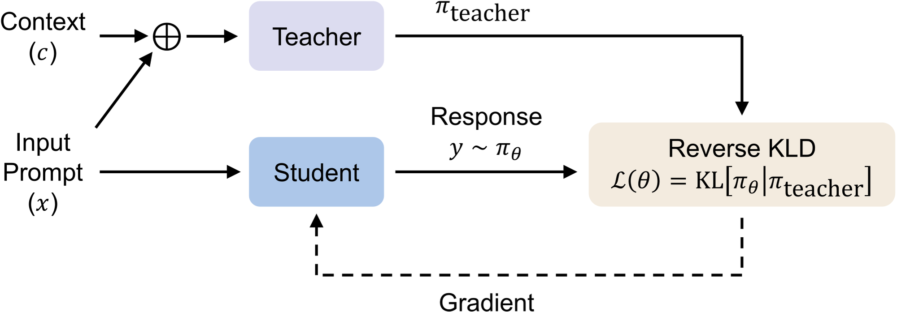
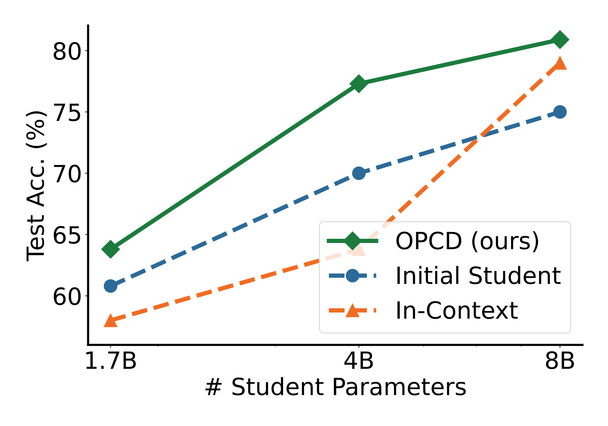
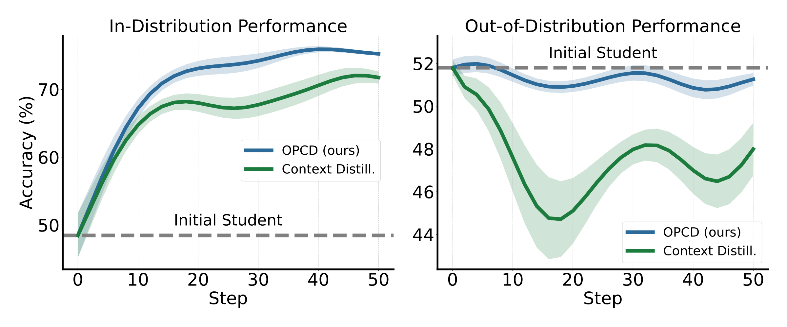

> **论文**：[On-Policy Context Distillation for Language Models](https://arxiv.org/html/2602.12275v2)
>
> **作者**：Tianzhu Ye、Li Dong、Xun Wu、Shaohan Huang、Furu Wei（前两位共同第一作者）
>
> **机构**：Microsoft Research
>
> **版本**：arXiv:2602.12275v2，2026-03-23；初稿发布于 2026-02-12
>
> **代码**：[OPCD 官方代码入口](https://aka.ms/opcd-code)

把一段解题经验放进 prompt，模型下一次可能做得更好；但去掉这段文字，收益往往也随之消失。Context distillation（上下文蒸馏）试图将这类临时指导转移到模型参数中，让模型以后不必重复读取相同上下文。

这篇论文的改变在于**训练时由谁生成轨迹**：学生先不带额外上下文完成回答，再由掌握经验或系统提示的教师，对学生已经走到的每一个生成位置提供概率分布监督。作者把它称为 On-Policy Context Distillation（OPCD）。

论文在数学、文字游戏和系统提示蒸馏上，大多优于教师生成数据的传统上下文蒸馏。例如，经过筛选的经验使 Qwen3-8B 数学测试准确率从 75.0% 提升到 80.9%，Qwen3-1.7B 的 Frozen Lake 成功率从 6.3% 提升到 38.3%。这些结果也有一个需要提前交代的评测问题：附录明确使用测试表现选择 checkpoint，后文会解释它为什么影响结论的强度。[论文 §4、附录 A–B](https://arxiv.org/html/2602.12275v2#S4)

## 教师不需要更大，但需要多看到一些东西

设当前问题是 $x$，想吸收的额外上下文是 $c$。两种角色的输入不同：

- 学生只看 $x$，必须按未来部署时的条件回答。
- 教师看 $c$ 和 $x$，可以利用额外经验、规则或系统提示。

教师可以是更大的模型，也可以与学生具有相同规模、相同初始权重。后一种设置中，教师的优势来自额外上下文。论文主实验默认冻结教师，只更新学生；因此模型相同并不意味着训练过程中两边权重始终相同。

传统上下文蒸馏通常让教师带着 $c$ 生成答案，再让学生模仿。学生训练时见到的是教师走过的前缀，部署时却必须接着自己生成的前缀往下写。学生一旦偏离教师的路径，就可能进入训练没有覆盖好的状态，这就是 exposure bias（暴露偏差）。

OPCD 选择让学生先生成，教师随后评估相同前缀：学生已经写了什么，教师就在这个基础上判断下一步的概率。这里的 on-policy 指训练轨迹来自当前学生，而不是来自固定的教师数据集；它不要求生成的答案已经正确。

## 在同一条学生轨迹上比较两个分布

*原论文 Figure 1：左侧额外上下文 $c$ 只进入上方教师，问题 $x$ 同时进入教师与学生；学生生成回答 $y$，右侧比较两者在这条回答上的 next-token 分布，虚线表示损失用于更新学生。部署时学生仍只接收问题。*

在第 $t$ 个生成位置，记

$$
p_t(v)=\pi_\theta(v\mid x,y_{<t}),\qquad
q_t(v)=\pi_{\mathrm{teacher}}(v\mid c,x,y_{<t}).
$$

$v$ 是候选 token，$y_{<t}$ 是学生已经生成的前缀；$p_t$ 是不带额外上下文的学生分布，$q_t$ 是带上下文的教师分布。两者评估的是同一个学生前缀，而不是各自独立生成一段回答后再对齐。

训练目标是：

$$
\begin{aligned}
\mathcal L(\theta)&=
\mathbb E_{(x,c)\sim\mathcal D,\;y\sim\pi_\theta(\cdot\mid x)}
\left[\frac{1}{|y|}\sum_{t=1}^{|y|}
D_{\mathrm{KL}}(p_t\|q_t)\right],\\[4pt]
D_{\mathrm{KL}}(p_t\|q_t)&=\sum_{v\in\mathcal V}p_t(v)\log\frac{p_t(v)}{q_t(v)}.
\end{aligned}
$$

$\mathcal D$ 是问题与上下文的训练集合，$|y|$ 是学生回答长度，$\mathcal V$ 是词表。外层期望表示不断用当前学生采样新轨迹；内层在各生成位置计算学生到教师的 reverse KL（反向 KL），并对长度取平均。

直觉上，如果学生把较高概率分给了教师认为不合适的 token，这一项会受到惩罚；如果某个 token 在教师看来更合理，优化会重新分配概率。它使用的是候选 token 的分布信息，不只是对最终答案给一个对错标签，也不只是模仿一条教师选出的文本。

Reverse KL 以学生概率加权，通常被理解为偏向教师分布中的高概率模式；forward KL 则按教师概率加权，更强调覆盖教师的分布。这个区别能帮助理解方法，但不能把它简化成“反向 KL 必然消除幻觉”：上下文可能有错，教师也可能判断错误。

实际实现只对学生概率最高的 256 个 token 求和，近似全词表 KL。自然语言描述训练循环就是：抽取问题，学生生成完整回答，教师读取“上下文＋问题＋学生回答”计算各位置概率，再更新学生。下一批使用更新后的学生重新采样。[论文 §3、附录 A.3、B.2](https://arxiv.org/html/2602.12275v2#S3)

### 冻结教师与共享权重是不同的训练选择

论文允许两类配置：

| 配置 | 教师与学生的关系 | 教师怎样变化 |
|---|---|---|
| Teacher–student distillation | 教师可以更大，也可以与学生从相同权重开始 | 可以冻结或定期更新；主实验使用冻结教师 |
| Self-distillation | 同一套权重承担两个角色，差别仅在是否输入 $c$ | 学生每次更新，教师也随之改变 |

因此，“自蒸馏”在本文中有严格含义：教师与学生实时共享权重。它不等同于所有“同尺寸教师教同尺寸学生”的实验。后者若冻结教师，仍属于第一类。

## 上下文从哪里来：经验与系统提示两条路线

### 从旧题中提炼可复用经验

经验蒸馏分三步。

第一步，模型解决一个问题，然后根据题目和自己的回答总结经验。数学场景不提供标准答案；文字游戏会提供交互中的环境反馈。因而这些经验是模型的自我归纳，不能自动视为已经验证的正确知识。

第二步，将不同问题产生的经验条目串接起来，构成 $c$。提取提示要求条目简洁、可复用，避免只记录某一道题的细节。例如，数学经验可以是利用模运算的周期性，或借助数位和判断模 9 的余数；游戏经验则涉及行动规则、避开危险与避免不可逆操作。

第三步，用这些经验增强教师，然后在另外的训练问题上运行 OPCD。学生在采样和最终部署时都不接收经验文本。

作者每次依次处理 30 个验证集问题，得到 30 份逐步累积的上下文，重复 10 次，共形成 300 份候选经验。论文区分两种使用方式：

- **随机经验设置**：不预先按正确率挑选经验。主结果随机抽取三份积累十步后的上下文，模拟没有标签来预评估经验质量的情形。
- **筛选经验设置**：将候选经验加到新问题前面，在 1000 道数学验证题或 128 个游戏验证实例上评分，选出最高分的上下文。这个版本使用了验证集评价信息，不能称为全流程无标签。

经验最长为数学 16,384 token、游戏 8192 token。模型需要吸收的是一个较长的经验集合，而不是一道题的单个标准答案。

### 把已优化的系统提示变成参数中的行为

第二条路线直接使用 MetaSPO 优化过的系统提示。教师带上提示，学生不带提示，在任务上做分布匹配。

医学任务使用 MedMCQA，要求选择答案并解释；安全任务将 TweetEval、HateCheck 和 ETHOS 组合起来，判断文本是否含冒犯或仇恨内容并解释。蒸馏同时覆盖回答与解释。这里的 safety 是这些分类任务的准确率，不能泛指一个模型所有安全能力。

这一应用不需要先提炼经验，但同样依赖一个前提：额外提示确实让教师在相关任务上产生更好的指导。[论文 §4.1–4.2、附录 A–B](https://arxiv.org/html/2602.12275v2#S4.SS1)

## 实验：经验可以留下来，收益也取决于经验质量

数学采用 DAPO-Math-17K 的英文部分，约 14K 道题，测试 1000 道。Frozen Lake 是一个 $3\times3$、有两个洞的导航环境；Sokoban 是 $6\times6$、一个箱子的推箱子环境，并移除部分显式规则让模型探索。两个游戏各测试 128 个实例。医学与安全任务各留出 500 个测试样本。

各任务训练 50 步、batch size 为 128，学习率在 $10^{-6}$ 与 $5\times10^{-6}$ 中搜索。数学回答最长 16,384 token；游戏最多交互 5 轮，每轮最多 1024 token；系统提示任务回答最长 512 token。

需要同时读清模型选择方式：经验实验每两步保存 checkpoint，再按最高测试准确率选择；系统提示实验报告测试表现最好的三个 checkpoint 的平均值。这不是完全独立于模型选择的最终测试，也不是三次独立训练的平均值。

下表的 In-Context 是直接给基础模型加经验，Context Distill. 是教师生成轨迹、使用 forward KL 的传统上下文蒸馏。三个方法名称描述的是不同训练或推理设置。

| 经验设置 / 模型 / 任务 | 基础模型 | In-Context | Context Distill. | OPCD |
|---|---:|---:|---:|---:|
| 随机 / Qwen3-8B / 数学 | 75.0 | 77.6 ± 1.1 | 78.5 ± 0.5 | **79.7 ± 0.5** |
| 随机 / Qwen3-1.7B / Frozen Lake | 6.3 | 20.2 ± 2.2 | 22.9 ± 4.0 | **26.5 ± 6.4** |
| 筛选 / Qwen3-8B / 数学 | 75.0 | 79.0 | 79.5 | **80.9** |
| 筛选 / Qwen3-1.7B / Frozen Lake | 6.3 | 31.4 | 35.2 | **38.3** |
| 筛选 / Qwen3-4B-Instruct-2507 / Sokoban | 9.4 | 48.4 | 51.6 | **53.9** |

*据原论文 Tables 1–2 重制，单位为准确率 %。随机经验实验的 ± 按原表保留；正文说明使用三份随机经验，但没有明确给出 ± 的统计定义。*

这些主实验使用与学生同尺寸的冻结教师。OPCD 在表中都高于传统上下文蒸馏，但增量大小不同：筛选经验时数学高 1.4 个百分点，Frozen Lake 高 3.1 个百分点，Sokoban 高 2.3 个百分点。相对基础模型的大幅提升中，也包含经验本身已经带来的收益。

OPCD 超过直接 In-Context 的结果，并不意味着把同一段信息压进参数就必然更强。学生蒸馏时还处理了额外训练问题，而用于提炼经验的题目来自验证集；作者也将接触这些训练数据视为额外学习信号。[论文 §4.3](https://arxiv.org/html/2602.12275v2#S4.SS3)

### 系统提示蒸馏：多数配置领先，也有例外

| 任务 / 模型 | 基础模型 | 加系统提示 | Context Distill. | OPCD |
|---|---:|---:|---:|---:|
| Medical / Llama-3.1-8B | 68.4 | 72.2 | 75.2 | **76.7** |
| Medical / Llama-3.2-3B | 59.4 | 66.4 | 71.0 | **76.3** |
| Medical / Qwen2.5-7B | 46.4 | 52.6 | 58.5 | **62.3** |
| Safety / Llama-3.1-8B | 70.7 | 75.3 | 77.2 | **79.6** |
| Safety / Llama-3.2-3B | 30.7 | 69.5 | **83.3** | 83.1 |
| Safety / Qwen2.5-7B | 69.1 | 72.7 | 77.0 | **78.1** |

*据原论文 Tables 3–4 重制，单位为 %。蒸馏后不需要额外系统提示；两种蒸馏均明显改善部分模型，但 Safety 的 Llama-3.2-3B 并未由 OPCD 取得最高分。*

医学 Llama-3.2-3B 的差异较大，OPCD 相对传统上下文蒸馏高 5.3 个百分点；安全任务同一模型却低 0.2 个百分点。结果支持这套训练组合在多种配置下有效，不能改写成“每个设置都胜出”。这些主表同样采用同尺寸冻结教师。[论文 §4.3](https://arxiv.org/html/2602.12275v2#S4.SS3)

## 三个对方法理解更有帮助的对照

### 直接堆旧回答，可能比没有经验更差

数学验证集的对照结果是：

| 经验处理方式 | 准确率 |
|---|---:|
| 不提供经验 | 75.1 |
| 直接放入旧问题与模型回答，Raw Trace | 70.5 |
| 先提炼经验，Knowledge | 77.4 |
| 提炼经验后再做 OPCD | **79.7** |

*据原论文 Table 6 重制，单位为 %。该表采用数学验证集、十步经验积累的实验口径，不与前面测试表混作同一组评测。*

旧轨迹包含题目细节、冗长推导，也可能包含错误。先提炼成可复用条目，比把历史对话原样保留下来更有效。不过，这里没有等长度的压缩或检索对照，不能把全部差异都归因为模型发现了更抽象的知识。[论文 §4.7](https://arxiv.org/html/2602.12275v2#S4.SS7)

### 小模型不一定能直接用好大模型的经验

*原论文 Figure 2：横轴为 Qwen3 学生参数规模，纵轴为数学测试准确率；蓝色圆点虚线是初始学生，橙色三角虚线是直接加入 Qwen3-8B 经验，绿色菱形实线是由冻结的 Qwen3-8B 教师进行 OPCD。1.7B 和 4B 的橙线低于蓝线，绿线则高于蓝线；8B 本身也能从蒸馏中获益。*

大模型能利用的一段经验，不一定适合小模型直接阅读。OPCD 先让教师解释经验，再在小模型实际生成的前缀上提供指导，可能降低经验与学生能力之间的落差。

不过，跨尺寸教师本身也能传递更强的推理能力。若要单独测量“经验迁移”的贡献，还需要比较同一个 8B 教师带经验与不带经验时的蒸馏结果；当前曲线不能把两种收益完全分开。[论文 §4.4](https://arxiv.org/html/2602.12275v2#S4.SS4)

### 实时更新教师，可能让监督目标不稳定

| 任务 / 学生 | 实时共享权重的 Self-OPCD | 冻结教师的 OPCD |
|---|---:|---:|
| Sokoban / Qwen3-4B-Instruct-2507 | 18.8 | **53.9** |
| Medical / Qwen2.5-3B-Instruct | 50.0 | **56.8** |

*据原论文 Table 5 重制，单位为 %。比较的是教师是否随学生同步变化，而不是有没有采用学生轨迹。*

两边都在更新时，学生面对的目标分布也不断移动。作者观察到 Self-OPCD 在训练若干步后可能发散，冻结教师则更稳定。这个结果为固定教师提供了实验依据，但不能外推成所有自蒸馏都会失败：论文脚注也指出，使用学生参数的指数移动平均（EMA）作为教师，可能缓解不稳定。[论文 §4.6](https://arxiv.org/html/2602.12275v2#S4.SS6)

## 更少遗忘，具体是保留了哪些能力

*原论文 Figure 3：横轴均为训练步数，左图是 Safety 同域准确率，右图是 Medical 域外准确率；灰色虚线表示初始学生。蓝线 OPCD 在左图高于绿线传统蒸馏，在右图接近初始水平，绿线则明显下降。阴影随曲线展示，但论文没有充分说明其统计口径。*

这张图采用冻结的 Qwen2.5-7B 教师训练 Qwen2.5-3B 学生，与前面主表的同尺寸教师不同。它支持“在提高安全分类准确率的同时，较少损伤医学问答能力”，论文文字报告域外表现相对传统蒸馏约高 4 个百分点。

经验蒸馏还用 IF-Eval 的 prompt-level strict accuracy 衡量域外指令遵循能力，即一条 prompt 的要求需要全部满足才计为正确。筛选经验实验的结果是：

| 训练领域 | 基础模型 IF-Eval | Context Distill. | OPCD |
|---|---:|---:|---:|
| 数学 | **81.3** | 80.4 | 80.8 |
| Frozen Lake | **67.3** | 65.4 | 66.7 |
| Sokoban | **82.8** | 82.3 | 82.4 |

*选自原论文 Table 2，单位为 %。OPCD 三项均高于传统蒸馏，但三项也都低于各自基础模型。*

因此，更准确的表述是“相对基线减轻遗忘”，而不是“训练后域外能力普遍提高”。随机经验的数学实验确有 IF-Eval 从 81.3 到 81.7 ± 0.4 的结果，但不能用这一项覆盖所有设置。[论文 §4.5](https://arxiv.org/html/2602.12275v2#S4.SS5)

## 思考与讨论

**经验是否可靠，应当与蒸馏是否有效分开判断。** 数学经验来自模型自己的未验证回答，游戏经验来自局部交互；提炼成条目并不会自动消除错误。筛选经验确实带来更好的结果，却需要验证数据和评价成本。若用于持续学习，一个自然的问题是：哪些经验值得固化，哪些更适合继续以可编辑的外部记忆保留？错误写进参数后的撤回成本，与修改一条文档不同。

**参数化迁移更适合反复复用的指导。** 稳定的任务流程、长期有效的系统提示，可以用训练减少重复上下文；经常更新的知识或临时用户偏好，则未必值得立即微调。本文训练还需要学生生成、教师额外前向计算，以及最多数百份经验候选的评估。未来若要评价真实效率，需要同时计入经验采集、筛选、训练与节省的推理成本。

**它与上一篇 Harness-Zero 共享目标，监督接口却不同。** 两者都试图把额外指导变成部署时无需重复加载的行为。OPCD 将经验或提示放在教师上下文里，在学生轨迹上匹配 token 分布；Harness-Zero 还要把工具、中间件等外部机制转成目标执行接口下的动作，再用审阅后的轨迹做 SFT。前者主要处理“谁看到上下文”，后者进一步处理“哪些动作在部署时可执行”。理解这个差别，有助于判断一个新场景需要分布监督、动作重写，还是两者结合。

## AI 犀利评判

1. **测试集参与了模型选择，削弱了最关键的评测证据。** 附录 A.3 明确每两步保存 checkpoint，并选测试准确率最高者；50 步意味着约 25 个候选。附录 B.2 又报告测试表现最好的三个 checkpoint 均值。这使测试集承担了验证集的功能，最终分数带有选择偏差。若没有另一个完全留出的测试集，80.9 对 79.5 这类小幅领先，不能当作无偏的泛化收益。

2. **方法同时改变轨迹来源与 KL 方向，却把收益较多归因于 on-policy。** Baseline 是教师轨迹＋forward KL，OPCD 是学生轨迹＋reverse KL。缺少“轨迹来源 × KL 方向”的 2×2 对照，就无法拆开暴露偏差缓解、分布匹配方向，以及二者交互各贡献多少。实验验证了这套组合有效，还没有单独识别 on-policy 的因果作用。

3. **不确定性报告不足以支撑“稳定胜出”。** 随机经验 Frozen Lake 的 OPCD 为 26.5 ± 6.4，传统蒸馏为 22.9 ± 4.0，均值差只有 3.6 个百分点；± 的定义又没有交代清楚。系统提示实验的三个 checkpoint 来自训练过程，不能替代三个独立种子。Safety 的 Llama-3.2-3B 甚至是 83.1 对 83.3 略输。应把结论限定为多数报告配置中的优势，而非普遍、显著的改进。

4. **“无标签学习”与“经验贡献”都需要按阶段划界。** 数学经验提取不看答案，但筛选经验使用验证正确率，最终 checkpoint 还按测试表现挑选；因此整个实验流程并非完全不依赖标签。跨尺寸实验又缺少同一强教师不带经验的对照，无法排除普通教师能力迁移的贡献。经验有效是有支持的观察，经验是全部增益来源则没有被证明。

5. **算法新意主要在组合与应用，而不是新的蒸馏原理。** 核心是已有的上下文蒸馏、学生轨迹采样与 reverse KL 训练的结合。数学题和两个小型游戏支持经验固化的可行性，但尚未验证长期、多次更新后的错误累积、跨任务干扰和可撤销性。将这些短程结果延伸为普遍的持续自我学习能力，跨度仍然很大。

总体判断：OPCD 提供了一套实用的上下文蒸馏组合，说明学生轨迹上的教师指导可以吸收经验并减轻部分遗忘；测试集选模型、因素混杂和有限的统计验证，使其目前更适合作为方法线索，而非持续学习与普遍泛化已经得到解决的证据。
