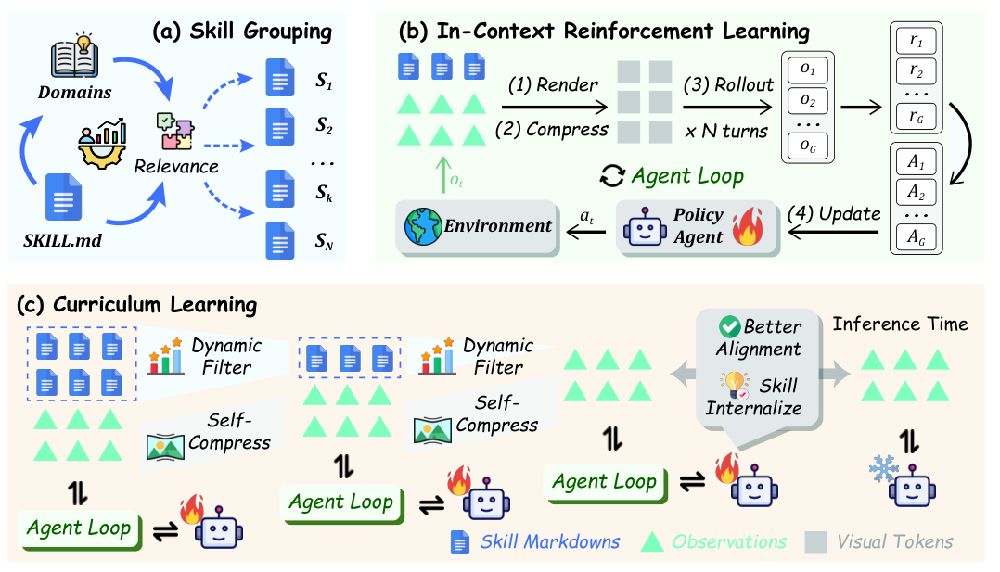
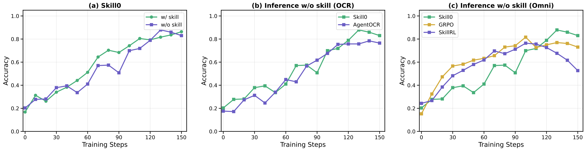
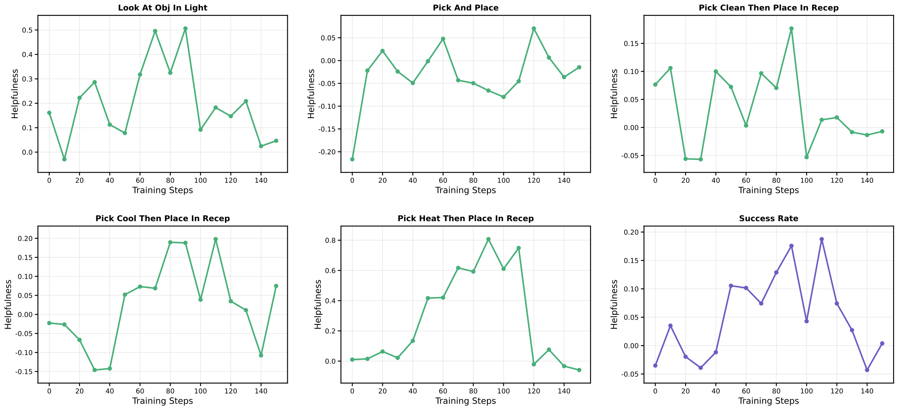

> **论文**　[SKILL0: In-Context Agentic Reinforcement Learning for Skill Internalization](https://arxiv.org/html/2604.02268v2)
>
> **作者**　Zhengxi Lu、Zhiyuan Yao、Jinyang Wu、Chengcheng Han、Qi Gu、Xunliang Cai、Weiming Lu、Jun Xiao、Yueting Zhuang、Yongliang Shen
>
> **机构**　浙江大学、美团、清华大学
>
> **版本**　arXiv v2，2026 年 5 月 15 日修订
>
> **代码**　[ZJU-REAL/SkillZero](https://github.com/ZJU-REAL/SkillZero)

在 WebShop 买一件有预算上限的商品时，Agent 在搜索页看到的起价可能低于所需尺码的实际价格。论文的购物 skill 要求模型选好规格后再核价，超预算就返回搜索。只要这句话一直写在提示里，一次正确购买就有两种解释。模型可能已经养成了核价的习惯，也可能只是当场读懂了说明。

Skill0 把“撤掉说明”放进训练过程。同一个模型先带着 skill 尝试任务，根据环境返回的奖励更新参数。训练越往后，可用的 skill 越少，最后一阶段完全撤掉，模型仍要继续购买、搜索或操作物体。这里的 **zero-shot** 指部署时提供零份技能文件，模型已经接受过相应任务的强化学习。在 ALFWorld 上，全程维持六份技能文件的预算，模型在无提示评测时得到 72.6%。把预算分三阶段收紧到 **6 → 3 → 0**，同一评测达到 **87.9%**。[附录 C，表 5](https://arxiv.org/html/2604.02268v2#A3.T5)

## 一条“选好规格再核价”的经验怎样参与训练

假设用户要买指定尺码、价格低于 50 美元的衣服。列表起价是 48 美元，选择尺码后变成 54 美元。这个价格例子是为了说明原论文 WebShop 技能库中的核价规则。一次带提示的训练，可能让模型多看一眼规格价格，返回列表，最终找到合适的商品。如果它直接按起价下单，就可能只满足用户的一部分要求。[附录 E，表 9](https://arxiv.org/html/2604.02268v2#A5.T9)

**技能文件提供操作经验，当前策略生成每一步动作，环境给整条交互轨迹打分。** 在这个例子里，负责点击商品、选择尺码和决定是否购买的，始终是正在接受训练的模型。系统无需为“回看价格”单独制作一条标准回复。训练会提高那些取得较高回报的轨迹中所选动作的概率。核价是否真的学会，仍要看撤掉文件后，模型遇到规格变价时怎样做。

*原论文图 2。左上把技能按任务类别分组。右上蓝色文档代表技能，绿色三角代表环境观察，灰色方块表示压缩后的视觉 token。模型完成多轮交互，再按一组轨迹各自的回报更新。下方从左往右展示训练进程，最后一个训练阶段和右侧推理阶段都已撤掉蓝色文档，环境观察仍然可用。*

模型要在多轮决策中记住自己已经做了什么。作者沿用 AgentOCR 的办法，将交互历史等文本渲染成图像，经视觉编码器压缩后交给 Qwen2.5-VL。图 2 也将技能画在待渲染的上下文中，附录 E 的实际提示模板则显式保留了 `{skill_context}` 插槽。每一步，模型给出任务动作，并为下一张历史图像选择压缩因子。这里压缩的是文字呈现出来的交互记录，WebShop 的购物任务仍然通过环境提供的动作完成。[论文 §3.1](https://arxiv.org/html/2604.02268v2#S3.SS1) [附录 E](https://arxiv.org/html/2604.02268v2#A5)

更新采用 GRPO（组相对策略优化）。对同一任务采样多条轨迹，把各自的总回报与组内平均值比较，得到每条轨迹的相对优势。回报包含任务表现和压缩项，压缩项只在轨迹成功时生效。式（4）把它写成 $\lambda\ln c_t$，$c_t$ 是该步的压缩比例，$\lambda$ 控制这项的权重。正文采用 $0<c_t\leq1$，附录提示要求模型输出大于 1 的压缩因子，两处量的换算关系没有明确给出。解读效率时，按实验报告的实际 token 数比较更直接。[论文 §3.2](https://arxiv.org/html/2604.02268v2#S3.SS2)

## 什么时候该撤掉一份技能文件？

作者把通用经验和任务专用经验整理进 **SkillBank**。一份 Markdown 文件可以包含多条规则。例如，ALFWorld 的清洗文件规定先拿目标物体、送到水槽清洗，再移动到指定位置放下。预算按**文件数**计。训练前从训练数据中划出验证子集，再按所需技能将任务分组，使“清洗”一类任务可以单独评估。

训练中默认每 10 步给当前模型做一次对照。把第 $k$ 类验证题上的提示收益记作

$$
\Delta_k = \mathrm{Acc}_k(\text{with skills}) - \mathrm{Acc}_k(\text{without skills}).
$$

两项使用同一阶段的策略和同一类验证任务。例如，假设带提示成功率为 75%，撤掉后为 55%，这类任务的 $\Delta_k$ 就是 20 个百分点，说明提示当前还有帮助。按论文算法 1，课程先筛掉 $\Delta_k\leq0$ 的候选，再按收益排序，在预算内优先保留分数较高的类别。这是 *on-policy helpfulness* 的含义，同一类指导的作用会随当前模型而变。

作者公开的 ALFWorld 和 Search-QA 训练器在同一批验证任务上运行两遍。开启技能时，每道题得到通用指导和当前仍被选中的匹配类别指导。关闭技能时，这一栏为空。两次成绩按任务类别做差。公开版本还在预算非零时为通用技能保留名额，并允许差值恰好为零的专用类别入选。这里描述的是公开提交 `1980cd5`，论文没有标明最初跑分对应的代码提交。[验证与差值计算](https://github.com/ZJU-REAL/SkillZero/blob/1980cd589036ec9f04c64749bbd317a8dd0eef7a/verl/trainer/ppo/ray_trainer.py#L1010-L1054) · [任务提示构造](https://github.com/ZJU-REAL/SkillZero/blob/1980cd589036ec9f04c64749bbd317a8dd0eef7a/agent_system/environments/env_manager.py#L407-L425) · [技能选择](https://github.com/ZJU-REAL/SkillZero/blob/1980cd589036ec9f04c64749bbd317a8dd0eef7a/agent_system/environments/curriculum_skill_manager.py#L121-L158)

每个阶段还能提供多少份文件，由下面的预算上限决定。

$$
M^{(s)}=\left\lceil N\,\frac{N_S-s}{N_S-1}\right\rceil .
$$

$N$ 是初始文件预算，$N_S$ 是训练阶段数，$s$ 从 1 数起。论文默认三个阶段，ALFWorld 的上限依次为 6、3、0，Search-QA 为 5、3、0。即使中间阶段仍有四类任务能从提示中获益，ALFWorld 也最多保留三份。到了最后阶段，策略必须在部署时的无技能条件下继续获取奖励。[论文 §3.3 与算法 1](https://arxiv.org/html/2604.02268v2#S3.SS3)

*原论文图 5。横轴是训练步数，纵轴是验证准确率。左图在同一模型上切换提示，绿色有提示、紫色无提示。约第 90 步两者为 0.69 和 0.51，第 120 步都接近 0.79。中图比较无提示的两种视觉方法，右图加入文本 GRPO 和 SkillRL，并统一撤掉技能提示。曲线会交叉，末步也未必取到峰值。*

*原论文图 6。横轴是训练步数，纵轴是带提示与无提示的表现差，各面板刻度不同。加热任务的差值在约第 90 步达到 0.8，到第 120 步接近零。单纯取放物体的差值则长期在零附近波动，若干次为负。右下紫线给出总体成功率的差值。*

图 6 也说明了为什么需要图 5。单看差值接近零，带提示和无提示可能是同样熟练，也可能是同样失败。只有同时看到无提示的绝对成绩上升，才有理由说模型在脱离提示后进步了。[论文 §4.3](https://arxiv.org/html/2604.02268v2#S4.SS3)

## 同样撤掉 skill，模型的成绩差多少？

作者用 Qwen2.5-VL 的 3B 和 7B 模型，在 4 张 H800 上最多训练 180 步。ALFWorld 涵盖取放、灯下查看、清洗、加热、冷却及取放两件物品六类家务。Search-QA 使用 E5 检索文档，训练数据来自 NQ 与 HotpotQA，另外五个问答数据集用于域外评估。WebShop 选取 1000 个训练任务，并在固定的 128 个验证任务上报告结果。无技能的 Search-QA 模型仍可调用 E5 查找事实。[论文 §4.1](https://arxiv.org/html/2604.02268v2#S4.SS1)

| 模型与方法 | ALFWorld 成功率 | Search-QA 七集平均 | WebShop 得分 | WebShop 准确率 |
|---|---:|---:|---:|---:|
| 3B 文本 GRPO | 79.9 | 36.4 | — | — |
| 3B AgentOCR | 78.2 | 34.2 | 75.2 | 56.3 |
| 3B SkillRL，推理带技能 | 82.4 | 38.9 | — | — |
| **3B Skill0，推理无技能** | **87.9** | **40.8** | **78.6** | **66.4** |
| 7B 文本 GRPO | 81.8 | 41.9 | — | — |
| 7B AgentOCR | 81.2 | 40.1 | 78.6 | 59.3 |
| 7B SkillRL，推理带技能 | 89.9 | 47.1 | — | — |
| **7B Skill0，推理无技能** | **89.8** | **44.4** | **85.1** | **74.2** |

*据原论文表 1、2 重制，成绩单位为 %。WebShop 分开报告得分 Score 和准确率 Accuracy。表中 SkillRL 的 3B 版本是省略冷启动与技能演化的简化复现。*

摘要中的 **+9.7、+6.6、+10.1**，分别来自 3B Skill0 相对同为视觉上下文的 AgentOCR 在 ALFWorld、Search-QA 和 WebShop **准确率**上的百分点差。换成 3B 文本 GRPO 作基线，前两项增量是 8.0 和 4.4 点。7B SkillRL 在部署时读取技能文件，ALFWorld 达到 89.9%，Search-QA 能达到 47.1%。相同规模的 Skill0 在无技能条件下分别达到 89.8% 和 44.4%。[原文表 1](https://arxiv.org/html/2604.02268v2#S4.T1) [原文表 2](https://arxiv.org/html/2604.02268v2#S4.T2)

论文的“每步少于 0.5k token”指**平均每步上下文长度**。3B Skill0 三个任务依次为 0.38k、0.18k 和 0.49k。对照 3B AgentOCR 的 0.38k、0.26k 和 0.42k，最清楚的收益出现在 Search-QA。WebShop 上 Skill0 每步多用约 70 个上下文 token，准确率高 10.1 点。若给训练后的 3B Skill0 重新加上技能，WebShop 上下文从 0.49k 增至 0.94k，Score 从 78.6 升到 80.9，Accuracy 从 66.4 降到 64.1。两个结果指标对重新加提示给出了不同方向的变化。

## 最能区分“会用说明”和“脱离说明也会做”的消融

| ALFWorld 3B 训练方案 | 推理带 skill | 推理撤掉 skill |
|---|---:|---:|
| 默认课程，预算 6 → 3 → 0，按收益筛选、排序 | 86.3 | **87.9** |
| 预算始终为 6，仍允许动态选择 | 85.9 | 72.6 |
| 从一开始就不给技能，预算始终为 0 | — | 78.9 |
| 五阶段预算 6 → 4 → 2 → 1 → 0 | 70.3 | 71.1 |
| 默认预算，取消正收益过滤 | 81.6 | 78.9 |
| 默认预算，用随机选择替代收益排序 | 76.6 | 62.9 |

*据原论文表 3 与附录表 5 重制，单位为成功率 %。同一行比较同一个训练方案切换推理提示的影响，同一列比较不同训练方案在相同推理设置下的结果。*

第一行与第二行在有提示时只差 0.4 点，撤掉提示后相差 **15.3 点**。在“先加热、再放置”这个子任务上，预算始终为 6 的模型从带提示的 95.2 跌到无提示的 25.8，默认课程在无提示条件下仍有 86.7。这是整篇论文最有辨识度的一组结果。如果只看带提示总分，会把两个部署行为很不一样的模型评为近乎相同。

选择哪些文件也有影响。在默认预算下，撤掉正收益过滤会让无提示成绩降低 9.0 点，随机挑文件会降低 25.0 点。另一方面，五阶段预算也能降到零，却只得到 71.1%。可见，终点设为零只规定了最后能看什么，各阶段看哪些文件、能练习多久，都会影响结果。[原文表 3](https://arxiv.org/html/2604.02268v2#S4.T4.fig1) [附录表 5](https://arxiv.org/html/2604.02268v2#A3.T5)

## 思考与讨论

**“内化了一条 skill”可以有比总分更具体的检验。** 以选规格后核价为例，构造两组其余条件一致的商品，一组变体价格不变，另一组选规格后超预算。撤掉提示，记录模型有多少次查看了变体价，以及有多少次在确认超预算后返回搜索。两次购买都可能碰巧成功，只有价格越过上限时的行动才能区分模型是否用上了核价结果。论文的任务成绩回答了能否脱离提示完成任务，这种干预实验还能追问到底学到了哪条规则。

**如果已有强教师按 skill 生成示范，Skill0 提供的是另一种训练条件。** 教师轨迹做 SFT 时，教师负责示范，小模型从第一天就可以只看任务。在 Skill0 中，早期直接读 skill 的恰恰是未来要部署的模型，后期再让它在无提示条件下用环境奖励练习。附录 E 的模板允许模型生成推理文本，也保留技能上下文插槽。论文考查的是撤掉 skill 后的任务表现，没有衡量训练轨迹中提及 skill 的频率。因而它对“怎样练习独立执行”给出了实验，对“怎样生成一条不提技能来源的教师轨迹”则没有直接做对照。[附录 E 的实际提示模板](https://arxiv.org/html/2604.02268v2#A5)

## AI 犀利评判

**任务类别的提示收益被解释成了单份文件的贡献。** §3.3 的文字比较提供单份技能与不给技能，算法 1 及公开训练器比较开关当前指导的差值，附录式（15）又把边际收益定义为只从集合里抽走第 $k$ 份文件。假如通用技能和“清洗”文件都提醒模型先拿起物体，一次撤掉两份会使成绩下降，单独抽掉任何一份却可能几乎没有影响。现有分数足以帮助分配提示预算，但用它说明某份文件贡献了多少，就缺了逐份消融的测量。[算法 1](https://arxiv.org/html/2604.02268v2#S3.SS3) [附录 A.2](https://arxiv.org/html/2604.02268v2#A1.SS2)

**文件数的上限不足以推出训练稳定性。** 附录 A.1 用相邻阶段的预算差来约束被移除的文件数。以预算 6 → 3 为例，若正收益过滤后只剩一份，实际可以一次撤掉五份，多于预算之差三份。即使文件数量只减少三份，一份长文档的影响也可能超过多份短文档。附录的分析还需假设单份技能对回报的影响有界，组内回报波动足以容纳这项扰动。因此三阶段课程在本文数据上的效果，不能仅由预算公式推导出来。[附录 A.1，式（9）–（14）](https://arxiv.org/html/2604.02268v2#A1.SS1)

**Search-QA 的平均提升高度集中。** 根据表 1 自行计算，3B 在 Bamboogle 上从 24.0 升到 63.7，单个数据集就给七集均分贡献约 5.7 点，其余六集的平均增量约为 1.0 点。7B 在 Bamboogle 上的 30.1 点增量除以七，已接近全部 4.3 点均分增量，其余六集平均基本持平。再考虑主表未给出跨训练种子的区间、WebShop 采用固定的 128 个验证任务，更稳妥的判断是具体任务上存在明显收益，收益在新任务之间的分布仍待检验。[原文表 1](https://arxiv.org/html/2604.02268v2#S4.T1)

**每步 token 数回答不了总成本问题。** 训练每隔若干步就要在分类验证题上跑有提示和无提示两套评估，部署还需渲染历史、调用视觉编码器。论文表 4 中，把评估间隔从 10 步缩至 5 步，ALFWorld 从 87.9 变为 87.5，Search-QA 子集从 48.9 变为 49.6。决定是否值得更频繁地筛选，还需要这些额外 rollout 的算力、端到端时延和预计部署次数。[原文表 4](https://arxiv.org/html/2604.02268v2#S4.T4.fig2)

本文的实验支持把无提示练习纳入 Agent 的强化学习课程，而逐条确认技能是否内化，还需要直接测量那些规则会改变的行动。
